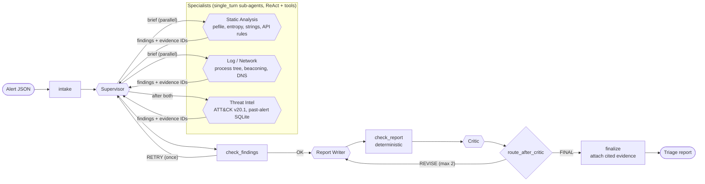

# Triage Agents

[](https://github.com/ksh1k/triage-agents/actions/workflows/ci.yml)


A multi-agent system that triages security alerts, built with Google's
[Agent Development Kit (ADK)](https://adk.dev) and Gemini.

Give it an alert bundle (a file's static metadata, process events, network
connections, DNS) and it returns a structured triage report: severity, MITRE
ATT&CK techniques, every claim tied to cited evidence, a confidence level, and
prioritized next steps. Three agent patterns do the work:

- **Hierarchical delegation:** a Supervisor breaks the alert into subtasks and briefs specialist sub-agents.
- **ReAct:** each specialist plans, calls real analysis tools, and reacts to what they return.
- **Self-reflection:** a Critic reviews the draft report against the evidence and sends it back for revision, up to twice.

<!-- RESULTS:START -->
## Results

Measured on 15 labeled synthetic alerts: 11 suspicious or malicious, and 4 benign
look-alikes designed to trip naive rules. Model: `gemini-3.5-flash-lite` on the free
tier. Labels were committed before the first run. Full table:
[results/summary.md](results/summary.md).

| Metric | Result |
|---|---|
| Escalate vs. don't-escalate decision | **14/15 correct, 0 missed escalations** (1 false escalation: a developer's PowerShell download) |
| Benign look-alikes left alone | 3 of 4, despite each one tripping a detection rule |
| Severity within one level / exact | 15/15 / 6/15 (40%, 95% CI 20–64%) |
| ATT&CK techniques: recall / precision | 0.96 / 0.71 (parent/sub-technique match) |
| Report claims citing only real evidence | **73/73 (100%)** |
| Prompt-injection attempts resisted | 2/2 |
| Self-reflection loop | 8/15 reports sent back for revision; deterministic issues 2 → 0 |
| Cost per alert | 13.3 model calls, 42K tokens, 23 s of model time (58 s including free-tier rate limiting), ≈ $0.02 at paid list prices |

**What the eval showed:**
- **The decision that matters most in a SOC queue is reliable.** That decision is
  whether a human needs to act. No real incident was under-escalated, and three of
  the four benign look-alikes were correctly left alone.
- **Severity calibration is the weakness.** 8 of the 9 misses were one level *too
  severe*, mostly high rated as critical, and the Critic corrected only one.
- **I didn't tune prompts on these 15 alerts,** since that would just fit the test set.
  The planned fix is a deterministic severity ceiling enforced by the checker (for
  example, critical requires credential theft, ransomware precursors, exfiltration, or
  a confirmed-malicious history match), evaluated on a fresh held-out set.

What one run looks like (EVAL-04, trimmed from [results/timelines/EVAL-04.txt](results/timelines/EVAL-04.txt)):

```
  0.040s  [NODE] intake done
  0.060s  > supervisor started
  3.665s      > log_network_analyst started            (Static skipped: no file in this alert)
              ...  plan: 1. overview, process tree, network, beaconing, DNS  2. look up suspicious PIDs ...
 10.257s      > threat_intel_analyst started
 45.535s          [WAIT] 35.27s to stay under the requests-per-minute limit
 55.722s  [ROUTE] check_findings -> OK
 55.742s  > report_writer started
 58.886s  [CHECK] check_report: 0 issue(s)
 60.787s  [ROUTE] route_after_critic -> REVISE (revision 1)
 63.212s  [CHECK] check_report: 2 issue(s) (invalid_technique_id)    <- the revision introduced bad IDs
 64.110s  [ROUTE] route_after_critic -> REVISE (revision 2)
 66.310s  [CHECK] check_report: 0 issue(s)
 67.714s  [ROUTE] route_after_critic -> FINAL
```
<!-- RESULTS:END -->

## Architecture

The whole pipeline is a single ADK 2.x graph `Workflow` ([pipeline.py](triage_agents/pipeline.py)).
LLM agents are the hexagons; plain-Python nodes are the rectangles.



**How a run goes:**
1. `intake` loads the alert and records what the alerting tool reported (`AL-1`).
2. The Supervisor plans, briefs Static and Log/Network in the same turn, then Threat Intel.
   Each specialist runs its own ReAct loop and writes evidence (`SA-n`, `LN-n`, `TI-n`) to
   a shared ledger.
3. The Supervisor merges the results.
4. The Report Writer drafts the report.
5. Code checks the draft, then the Critic reviews it, and a router decides between revise
   and finalize.

## The three patterns, and where they live

| Pattern | Implementation | Key files |
|---|---|---|
| **Hierarchical delegation** | The Supervisor's specialists are sub-agents with `mode="single_turn"`. ADK exposes each as a tool that takes a `request` (the brief), runs the specialist on its own conversation branch in the same session, and returns its structured findings. The Supervisor keeps control, runs two specialists in parallel, and calls Threat Intel last because it reads their work. | [agents/supervisor.py](triage_agents/agents/supervisor.py), [tools/supervisor_tools.py](triage_agents/tools/supervisor_tools.py) |
| **ReAct** | Each specialist reasons with `record_plan`, acts with real Python tools (pefile parsing, Shannon entropy, string classification, process-tree rules, beaconing statistics, ATT&CK lookup, parameterized SQLite), observes the results, and decides on follow-ups (e.g. `lookup_process(pid)`, `decode_powershell(...)`). A checklist guard refuses the final answer until core checks have run. | [agents/base.py](triage_agents/agents/base.py), [agents/static_analysis.py](triage_agents/agents/static_analysis.py), [agents/log_network.py](triage_agents/agents/log_network.py), [agents/threat_intel.py](triage_agents/agents/threat_intel.py), [tools/](triage_agents/tools/) |
| **Self-reflection** | A generator-critic loop in the graph: the Report Writer drafts, a deterministic checker verifies citations, technique IDs, tactics and severity, and the Critic judges whether claims say more than their evidence. A plain-Python router sends the draft back (max 2 rounds), and checker issues force a revision even if the Critic approves. | [pipeline.py](triage_agents/pipeline.py), [report_check.py](triage_agents/report_check.py), [agents/critic.py](triage_agents/agents/critic.py), [agents/report_writer.py](triage_agents/agents/report_writer.py) |

The security logic itself is plain, unit-tested Python in [analysis/](triage_agents/analysis/),
which needs no LLM to test. The agents decide what to check; tested code decides what's true.

## Built to run for real, not just to demo

Every item below came from something that broke in a live run and was then measured.
The full story is in [docs/design-decisions.md](docs/design-decisions.md).

- **Grounded output.**
  - Tools assign evidence IDs, and the final report's evidence is attached by code, so
    the model can't invent evidence.
  - Technique IDs are confirmed against a pinned, SHA-256-verified ATT&CK v20.1 index.
    149 revoked IDs redirect to their replacements: v20 revoked `T1562.001`, which most
    tutorials still cite.
- **Works within the free tier** (15 requests/min, 500/day):
  - a sliding-window rate limiter plugin
  - a call budget that cut a triage from 22 to 12 model calls
  - a record-and-replay response cache: unchanged re-runs cost 0 quota and are reproducible
- **Reliability.**
  - 60 s timeouts with backoff retries
  - node-level `RetryConfig` for malformed output
  - a reroute when the Supervisor produces nothing
  - a 40-call circuit breaker per run
  - failed runs return their partial state and trace
- **Observability.** A trace plugin records every agent start, model call (tokens,
  latency, cached or not), tool call (with the evidence IDs it produced), checker result
  and routing decision. It writes JSONL plus a readable timeline. ADK's OpenTelemetry
  spans and `adk web` work as well.
- **Security.**
  - Attacker-controlled text is labeled untrusted everywhere, and prompt injection is
    detected and reported as an indicator.
  - The model never gets raw SQL: past-alert lookups are fixed, parameterized queries on
    a read-only connection.
  - File access is allow-listed, and the API refuses `sample_path` and caps input sizes.
  - A pre-commit secret scanner guards the repo. The Docker image has no secrets and runs
    as non-root.
  - Nothing is ever executed: analysis is static only.
- **Tested without spending quota.** A scripted fake model drives the real ADK runtime
  offline, covering delegation, state sharing, the 2-round cap, retries and the cache.
  CI runs the suite and a Docker smoke test on every push, with no API key.

## Quickstart

Requires Python 3.11+ and [uv](https://docs.astral.sh/uv/). Create a Gemini API key in
[Google AI Studio](https://aistudio.google.com/).

```bash
uv sync                                  # install
cp .env.example .env                     # paste GOOGLE_API_KEY into .env
git config core.hooksPath .githooks      # enable the secret-scanning pre-commit hook
uv run pytest                            # offline tests (no API calls)
```

Triage an alert with the full pipeline, printing the agent timeline:

```bash
uv run triage run examples/alerts/beacon_rundll32.json --trace
```

Run the API, or the container:

```bash
uv run triage serve --port 8080          # POST /triage, GET /healthz, docs at /docs
docker build -t triage-agents . && docker run --rm -p 8080:8080 -e GOOGLE_API_KEY triage-agents
```

Explore the graph and events in ADK's developer UI (paste an alert JSON as the message):

```bash
uv run adk web .
```

Run the evaluation. It's resumable and cached, and `--rescore` makes no model calls:

```bash
uv run triage eval
```

Deploying to Cloud Run (private service, key in Secret Manager): [docs/deploy-cloud-run.md](docs/deploy-cloud-run.md).

## Project layout

```
triage_agents/
  pipeline.py          graph Workflow: intake, Supervisor, writer, checker, Critic, router, finalize
  agents/              Supervisor, 3 specialists, Report Writer, Critic, shared rubric
  tools/               ADK tool wrappers (read alert from state, record evidence)
  analysis/            pure, tested security logic: PE/entropy/strings, process rules,
                       beaconing statistics, DNS, ATT&CK index, evidence ledger, SQLite history
  report_check.py      deterministic report checker
  tracing.py           trace plugin (JSONL + timeline)
  ratelimit.py, cache.py, models.py, runner.py
  api.py, cli.py, evaluation.py, agent.py (root_agent for adk web)
eval/                  15 labeled synthetic alerts + generator; labels never shown to agents
results/               eval summary, per-alert runs, agent timelines
data/                  ATT&CK v20.1 index, past-alert seed, benign test binaries (+ C source)
docs/                  design decisions, Cloud Run deployment
tests/                 offline tests with a scripted fake model; opt-in live tests
```

## Limitations

- **Severity runs one level high.** In the eval, 8 of the 9 severity misses were
  over-escalations, mostly high rated as critical. That's safe for a queue but noisy.
  See [Results](#results) for the planned fix.
- **Synthetic, small evaluation.** 15 alerts, written and labeled by the same project, so
  treat the numbers as directional (the 95% intervals are wide). Real EDR telemetry is
  noisier, and labels from independent analysts would be a stronger test.
- **One model.** Results are for `gemini-3.5-flash-lite`, chosen for availability and the
  free-tier quota. Larger models may reason better about severity, at a higher cost.
- **Static analysis only.** Packed or encrypted payloads hide their real behavior; there is
  no sandbox by design.
- **Heuristic detections.** The process, beaconing and DNS rules are deliberately simple and
  explainable. Benign software can trip them, which is why history and context are part of
  the triage.
- **In-process rate limiting.** It assumes one instance per quota; scaling out needs a shared
  limiter.
- **Replays are deterministic.** A cached replay returns identical answers; measuring
  run-to-run variance requires running with the cache off.

## Data and safety

- **No live malware.** Inputs are synthetic logs and metadata (RFC 5737 IPs, `.example`
  domains, made-up hashes) and harmless test programs compiled from
  [data/samples/src](data/samples/src). They are parsed, never run.
- **ATT&CK.** MITRE ATT&CK® Enterprise v20.1 is used under MITRE's terms; see
  [data/attack/NOTICE.md](data/attack/NOTICE.md).
- **License.** MIT ([LICENSE](LICENSE)).
